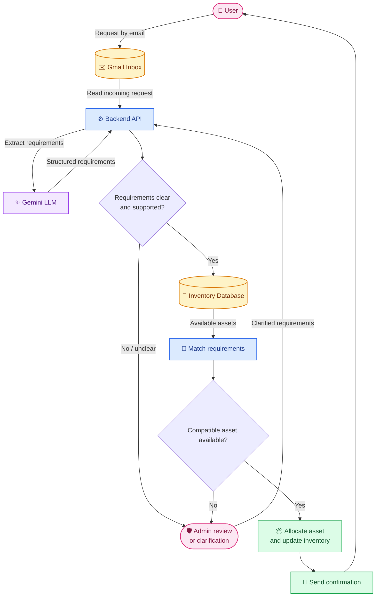

<p align="center">
  
</p>

<h1 align="center">Intelligent IT Resource Allocation System</h1>

<p align="center">
  Email-driven IT resource requests, inventory matching, and administrator-controlled allocation.
</p>

<p align="center">
  <a href="https://agentic-resource-allocator.vercel.app">Live Application</a>
</p>

## Table of Contents

- [Overview](#overview)
- [System Architecture](#system-architecture)
- [Tech Stack](#tech-stack)
- [Run Locally](#run-locally)
- [Environment Variables](#environment-variables)
- [Current Limitations](#current-limitations)
- [Future Improvements](#future-improvements)

## Overview

The Intelligent IT Resource Allocation System helps IT teams process equipment requests submitted through the web application or a configured Gmail inbox. It extracts requirements, compares them with recorded inventory, recommends compatible assets, and supports administrator review and allocation. Requests that are ambiguous or cannot be fulfilled can be escalated instead of assigning incompatible equipment.

## System Architecture



**Allocation flow:** The matcher filters inventory by category and hard hardware requirements, then ranks eligible assets. The backend revalidates request state, compatibility, and asset availability before creating an assignment and updating inventory. Requests that cannot be matched may be sent for administrator review.

## Tech Stack

| Layer | Technologies |
|---|---|
| Frontend | React, Vite |
| Backend | Node.js, Express |
| Database | MongoDB / MongoDB Atlas |
| Requirement extraction | Python, FastAPI; Gemini when configured, with stub mode available |
| Email | Gmail API / OAuth, shared HTML notification templates |
| Testing | Backend Jest tests, Python `unittest`, frontend lint/build |
| Deployment | Vercel, Render, MongoDB Atlas |

## Run Locally

### Prerequisites

- Node.js and npm
- Python 3
- MongoDB local instance or MongoDB Atlas URI
- Gmail OAuth credentials if testing Gmail intake
- Gemini API key if using Gemini-backed extraction

### 1. Start the extraction agent

```bash
cd agent
python -m venv .venv
# Activate the virtual environment, then install dependencies:
pip install -r requirements.txt
uvicorn app.main:app --reload --port 9000
```

### 2. Start the backend

In a separate terminal:

```bash
cd server
npm install
npm run dev
```

Set the backend's agent URL and database connection before starting it.

### 3. Start the frontend

In another terminal:

```bash
cd frontend
npm install
npm run dev
```

Open the local URL printed by Vite (typically `http://localhost:5173`).

> Check each package's existing scripts and the deployment documentation if a command differs in your branch. Use a test database and test accounts; never run demo-seeding scripts against production inventory.

## Environment Variables

Create local `.env` files for the relevant services. Use the exact names expected by your current branch and **never commit secrets**.

### Frontend — `frontend/.env`

| Variable | Purpose |
|---|---|
| `VITE_API_BASE` | Backend API base URL, including `/api` (local example: `http://localhost:8080/api`) |

### Backend — `server/.env`

| Variable | Purpose |
|---|---|
| `MONGODB_URI` | MongoDB connection string |
| `JWT_SECRET` | Authentication token signing secret |
| `CORS_ORIGIN` | Allowed frontend origin (local example: `http://localhost:5173`) |
| `AGENT_BASE_URL` | Python agent URL (local example: `http://localhost:9000`) |
| `GMAIL_CLIENT_ID` | Google OAuth client ID, if Gmail intake is enabled |
| `GMAIL_CLIENT_SECRET` | Google OAuth client secret, if Gmail intake is enabled |
| `GMAIL_REFRESH_TOKEN` | Gmail OAuth refresh token, if Gmail intake is enabled |
| `GMAIL_USER_EMAIL` | Mailbox used for Gmail intake |
| `ADMIN_EMAIL` | Administrator / notification recipient where configured |

### Agent — `agent/.env`

| Variable | Purpose |
|---|---|
| `STUB_MODE` | Enables stub extraction when set to `true` |
| `GEMINI_API_KEY` | API key for Gemini-backed extraction, when enabled |

**Configuration note:** The required variables depend on the selected providers and current branch. Verify names and defaults in `server/src/config`, `agent/app/config.py`, and the deployment documentation. The core application can be tested without enabling Gmail intake; Gmail and Gemini features need their respective configuration.

## Current Limitations

- **Synchronous Processing:** Request processing is not fully asynchronous, which may cause delays when handling multiple requests simultaneously or when AI extraction takes longer than expected.
- **Ambiguous Email Requests:** The system may struggle to interpret unstructured emails containing vague, incomplete, or contradictory requirements, resulting in inaccurate extraction or unsuccessful matching.
- **Requirement Interpretation:** Implicit preferences and unclear hardware specifications may not be interpreted reliably, potentially requiring manual administrator intervention.
- **Inventory Dependency:** Successful allocation depends on the availability of compatible assets and sufficiently complete inventory specifications.

## Future Improvements

- **Asynchronous Request Processing:** Introduce a background job queue to process email intake, requirement extraction, matching, and notifications independently, improving responsiveness and scalability under concurrent workloads.
- **Improved Requirement Understanding:** Enhance LLM-based extraction to handle natural language, ambiguous descriptions, conflicting constraints, and varied email formats while distinguishing explicit requirements from inferred preferences.
- **Automated Clarification Workflow:** Enable the system to identify missing or contradictory requirements and send targeted follow-up emails to requesters before proceeding with allocation.
- **Confidence-Aware Allocation:** Introduce validation and uncertainty checks so that only sufficiently clear and compatible requests proceed automatically, while uncertain cases are escalated to administrators.
- **Enhanced Inventory Intelligence:** Improve asset recommendations using richer inventory metadata, preference-based ranking, and more informative explanations for incompatible resources.