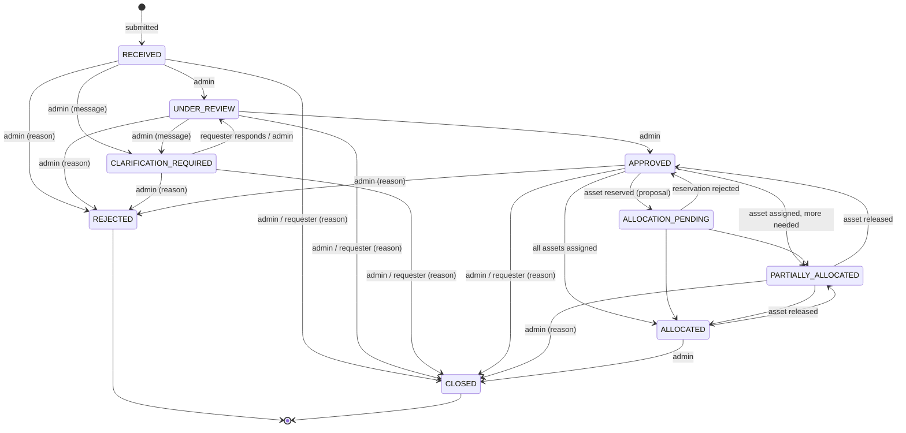

# IT Resource Request & Allocation — Core Workflow

Status: milestone 1 (core workflow) + phase 2 (deterministic asset matching). Discovery notes on the original helpdesk live in [project-discovery/](project-discovery/); this document describes what was added on top.

## Purpose

Requesters at an institution (students, staff, faculty) ask for IT resources: computers, workstations, servers, GPU systems, networking or storage. IT administrators review the request, ask for clarification if needed, approve or reject it, and assign specific inventory assets. Every status change and allocation is recorded.

The existing support-ticket workflow (tickets, AI triage, knowledge base, agent dashboard) is unchanged and still available under **Support Tickets**. Resource requests are **not** sent to the AI worker. Matching of requests to inventory is deterministic and rule-based (see [Asset matching](#asset-matching)); AI-assisted requirement extraction is planned for a later milestone.

## Roles

| Role | How it is obtained | Can do |
|---|---|---|
| `user` (requester) | Public registration (always `user`) | Submit requests; view, edit (while `RECEIVED`/`CLARIFICATION_REQUIRED`), respond to clarification and withdraw **their own** requests |
| `admin` (IT administrator) | `npm run set-role` (see below) | Everything a requester can do, plus: review all requests, transitions, inventory management, assignment |
| `agent` | `npm run set-role` | Legacy support-ticket role; treated as a requester for resources |

Promote an existing account (non-destructive; changes only that user's role):

```bash
cd server
npm run set-role -- --email someone@college.edu --role admin
```

## Request lifecycle



Rules (enforced in the backend; source of truth: [server/src/domain/resourceCatalog.js](../server/src/domain/resourceCatalog.js)):

- Manual transitions are limited to the `MANUAL_TRANSITIONS` table, with per-transition roles and a required `reason`/`message` where noted.
- `ALLOCATION_PENDING`, `PARTIALLY_ALLOCATED`, `ALLOCATED` (and falling back to `APPROVED`) are **never set manually**. They are derived from recorded assignments by `deriveAllocationStatus`, so a request cannot be "allocated" without assignment records.
- `REJECTED` and `CLOSED` are terminal. Nothing (including the AI triage endpoint, which only handles support tickets) can reopen them.
- Rejecting requires that nothing is assigned or reserved; closing requires that no reservation is pending. Closing **keeps** active assignments and all records (assets stay with the requester until an admin releases them).
- Clarification keeps the request's content; the requester's answer and any edits are recorded in history. The submission as originally received is kept in `original` and never modified.
- Each transition is a single conditional update (`status` precondition in the filter), so concurrent transitions cannot both succeed.

## Data model

| Collection | Model file | Key fields |
|---|---|---|
| `resourcerequests` | [ResourceRequest.js](../server/src/models/ResourceRequest.js) | `requester`, `department`, `title`, `category`, `purpose`, `description`, `specifications`, `quantity` (1–50), `urgency`, `neededBy`, `original` (immutable snapshot), `status`, `allocation {active, proposed}`, `rejection`, `pendingClarification`, `closure`, `history[]` |
| `assets` | [Asset.js](../server/src/models/Asset.js) | `assetTag` (unique, immutable), `name`, `category`, `manufacturer`, `model`, `serialNumber`, `specs`, `operatingSystem`, `software[]`, `location`, `department`, `status`, `currentAssignment`, `notes`, timestamps |
| `assignments` | [Assignment.js](../server/src/models/Assignment.js) | `request`, `asset`, `status` (`proposed`/`active`/`rejected`/`released`), `isCurrent`, `assignedBy/At`, `approvedBy/At`, `endedBy/At`, `endReason`, `notes` |
| `users` | [User.js](../server/src/models/User.js) | added optional `department` |
| `notifications` | [Notification.js](../server/src/models/Notification.js) | added type `request_update` |

- **Specifications** (`specifications` on requests, `specs` on assets) share one vocabulary (`SPEC_FIELDS`: CPU cores, memory, storage, GPU model/count/memory, OS, form factor, network ports/speed). All optional; unknown keys and out-of-range values are rejected at the API and by a Mongoose validator. Categories declare which fields are most relevant (shown first in the UI).
- **History** is embedded in the request and written in the same update as the status change.
- **Assignments** are never deleted; ending one sets `status` and `isCurrent=false`.
- **Indexes**: requests `{requester, createdAt}`, `{status, createdAt}`, `{category, status}`, `{urgency, status}`; assets unique `{assetTag}`, `{category, status}`, `{status, updatedAt}`; assignments partial-unique `{asset}` where `isCurrent: true`, `{request, status}`, `{asset, createdAt}`, `{status, createdAt}`.
- **Migration**: none required. All new collections; the two additive fields default to empty. No existing data is modified. Indexes are built by Mongoose `autoIndex` on startup.

Asset statuses: `available`, `reserved` (held by a proposal), `allocated` (held by an active assignment), `maintenance`, `unavailable`, `retired`. Admins may set only `available`/`maintenance`/`unavailable`/`retired`, and only while the asset holds no assignment.

## Allocation consistency strategy

Implemented in [allocationService.js](../server/src/services/allocationService.js).

1. Each assign / approve / reject / release runs in **one MongoDB transaction** touching Asset, Assignment and ResourceRequest.
2. Every write is a **conditional update** whose filter is the precondition:
   - asset `{status: 'available', currentAssignment: null}` → claimed;
   - request `{status ∈ APPROVED|ALLOCATION_PENDING|PARTIALLY_ALLOCATED, active + proposed < quantity}` → counter incremented;
   - assignment `{status: 'proposed'}` → approved, etc.
3. A failed precondition throws, aborting the transaction and rolling back earlier writes (e.g. an asset claimed for a request that turns out to be full is released).
4. Concurrent claims of the same asset conflict on the asset document; MongoDB aborts one, the driver retries it, its precondition then fails → `409`. Exactly one succeeds.
5. **Second guard**: a partial unique index on `assignments.asset` where `isCurrent: true` makes two current assignments for one asset impossible at the database level, even if application logic regressed.
6. The request's `allocation` counters are denormalised for the atomic capacity check; Assignment documents remain the source of truth and are updated in the same transaction.
7. **Compatibility is re-checked inside the transaction** (phase 2): after the asset is claimed, the matching rules are evaluated against the asset document as just written and the request as read in the same session. An `incompatible` or `unverified` asset aborts the transaction (`409`, claim rolled back). Approving a reservation re-checks too, because asset specs may be edited while reserved. Matching results are never trusted by the allocation endpoint.

Verified deployment: the configured Atlas cluster is a 3-member replica set on MongoDB 8.0, so transactions are supported. On a standalone `mongod` (no replica set) allocation endpoints return **503** with an explanatory message rather than running without atomicity; all other features work. For local development use Atlas or `mongod --replSet`.

## Asset matching

Implemented in [domain/matching.js](../server/src/domain/matching.js) (pure rules, shared with allocation) and [services/matchingService.js](../server/src/services/matchingService.js) (read-only endpoint). No ML or LLM is involved; results are fully determined by the request, the inventory and the rules below (version `fit-v1`).

### Requirements: what each stated field means

The request schema has a single `specifications` object; it does not distinguish minimums from preferences, so each field's meaning is fixed by these rules. A field the requester left blank is **unspecified** and imposes nothing.

| Request field | Kind | Asset satisfies it when |
|---|---|---|
| `category` (always) | exact | `asset.category` equals it. Assets in other categories are not evaluated in detail, only counted. |
| `cpuCores`, `memoryGb`, `storageGb`, `gpuCount`, `gpuMemoryGb`, `networkPorts`, `networkSpeedGbps` | minimum | asset value ≥ requested value |
| `storageType` | minimum tier | asset tier ≥ requested tier, with HDD < SSD < NVMe |
| `formFactor` | exact (`any` = unspecified) | asset form factor equals it |
| `operatingSystem` | compatibility | see OS rules below |
| any of `gpuModel`, `gpuCount`, `gpuMemoryGb` | capability | asset has a GPU: `gpuCount ≥ 1`, or a GPU model/memory is recorded. No GPU data means **unverified**, not "no GPU" (see limitations). |
| `gpuModel` | **preference** only | free text (e.g. "any CUDA-capable") cannot be verified structurally; it is used for ranking and implies a GPU is required |

`department` (request) is used only as a ranking preference. Requests have no location, manufacturer or software fields, so these are not matched; asset `software` is free text and is not matched either.

**Operating system** (asset value: `asset.operatingSystem`, falling back to `asset.specs.operatingSystem`):
- every word of the requested OS appears in the asset's OS (e.g. "Windows 11" vs "Windows 11 Pro") → meets, exact;
- requested "Linux" and the asset runs a recognised Linux distribution → meets;
- both recognised but different families (e.g. Ubuntu vs Windows, Ubuntu vs Rocky) → **fails**;
- same family, different version/edition (Ubuntu 20.04 vs 22.04), or either side unrecognised → **unverified**, never "fails".

### Eligibility

Each asset gets one of:
- `compatible`: every stated requirement is verified as met;
- `incompatible`: at least one requirement verifiably fails;
- `unverified`: nothing fails, but at least one requirement cannot be checked because the asset record lacks the data. **Missing asset data is never treated as compatible.** The result lists exactly which facts are missing.

Only assets that are `compatible` **and** available (`status: available`, no current assignment) are offered for assignment. The allocation service enforces the same rule.

### Ranking (compatible, available assets only)

Points are for ordering only; they are not a probability or a confidence.

| Rule | Points |
|---|---|
| Closeness of fit: average of `required / actual` over all minimum and tier requirements, × 60. Best fit ranks first, which keeps higher-spec assets free for requests that need them. Omitted if the request states no minimums. | 0–60 |
| GPU model preference: asset GPU model contains every significant word of the requested model (generic words such as "any", "capable", "gpu", "cuda" are ignored) | +15 |
| OS exact: the OS matched word-for-word, not just by Linux family | +10 |
| Department: asset department equals the request department (case-insensitive) | +10 |

Ties break by asset tag (alphabetical), so ordering is stable. Preferences are only scored for compatible assets, so **a preference can never compensate for a failed or unverified requirement**. Incompatible and unverified assets have `score: null`.

### Missing or ambiguous request information

Request-level warnings are returned rather than guessing:

| Code | Severity | When |
|---|---|---|
| `NO_STRUCTURED_REQUIREMENTS` | warning | no specifications at all; only the category is checked |
| `UNSPECIFIED_FIELDS` | info | fields relevant to the category that the requester left blank (not checked) |
| `UNRECOGNISED_OS` | warning | the requested OS is not a recognised family |
| `FREE_TEXT_GPU_MODEL` | info | GPU model given as free text; used for ranking only |
| `CATEGORY_OTHER` | warning | category "Other"; only "Other" assets are considered |
| `NOT_ALLOCATABLE` | info | request not yet approved (preview) or finished |
| `NO_REMAINING_QUANTITY` | info | everything requested is already assigned or reserved |

### Endpoint

`GET /api/requests/:id/matches`: **admin only** (`401` unauthenticated, `403` for requesters including the owner and agents, `400` malformed id, `404` unknown request). Read-only: it never creates assignments, reserves assets or changes the request. It works for any request status; before approval it is a preview (`request.allocatable: false`).

```jsonc
{
  "requestId": "…", "generatedAt": "ISO date", "advisory": true,
  "method": { "version": "fit-v1", "scoring": { "FIT_MAX": 60, "GPU_MODEL_MATCH": 15, "OS_EXACT": 10, "DEPARTMENT_MATCH": 10 } },
  "request": { "status": "APPROVED", "category": "server", "quantity": 1, "remaining": 1, "allocatable": true },
  "requirements": [{ "field": "memoryGb", "label": "Memory (RAM)", "kind": "minimum", "value": 64, "display": "at least 64 GB" }],
  "warnings": [{ "code": "UNSPECIFIED_FIELDS", "severity": "info", "message": "…" }],
  "candidates": {
    "eligible":          [Candidate],  // compatible + available, best first
    "needsVerification": [Candidate],  // available, nothing failed, data missing
    "unavailable":       [Candidate],  // compatible or unverified, but not available
    "incompatible":      [Candidate]   // same category, at least one requirement fails
  },
  "summary": { "evaluated": 6, "eligible": 2, "needsVerification": 1, "incompatible": 2, "unavailable": 1,
               "unavailableCompatible": 1, "otherCategoryAvailable": 5 },
  "explanation": "string when there are no eligible candidates, else null"
}
// Candidate
{
  "asset": { "_id", "assetTag", "name", "category", "manufacturer", "model", "specs", "operatingSystem", "location", "department" },
  "availability": { "status": "available", "available": true },
  "eligibility": "compatible" | "unverified" | "incompatible",
  "score": 70 | null,
  "scoreBreakdown": [{ "rule": "fit", "points": 60, "message": "…" }],
  "comparisons": [{ "field": "memoryGb", "label": "Memory (RAM)", "required": 64, "actual": 64, "result": "meets|exceeds|fails|missing", "message": "…" }],
  "matches": ["…"], "failures": ["…"], "unverified": ["…"], "preferences": ["…"]
}
```

### Safety guarantees

Matching is advisory. The allocation endpoint ignores any client-side ranking or eligibility and, inside its transaction, re-checks availability (conditional claim), compatibility (same rules, on the claimed document), request status and remaining quantity. So a stale recommendation (asset edited, taken by another request, or put into maintenance after matching) results in a `409` with the reason, and nothing changes. The partial unique index on current assignments is unchanged.

### Matching limitations

- Only the structured fields above are compared. The free-text description and purpose are not interpreted.
- Requests cannot yet express "preferred" values separately from minimums; adding that needs a schema change.
- Asset records with incomplete specs are reported as `unverified` and cannot be assigned until completed. This is deliberate, but it means inventory data quality directly limits assignment.
- OS matching uses a fixed list of families (Windows, macOS, and common Linux distributions); anything else needs manual verification.
- Each call evaluates every non-retired asset in the request's category in memory. That is fine for institution-sized inventories (hundreds to low thousands of assets per category), but would need query-side filtering at larger scale.
- Matching only considers the request's own category; there is no cross-category substitution.
- The catalog's `gpuCount` minimum is 1, so an asset cannot be recorded as having *no* GPU. For a GPU requirement, a GPU-less asset therefore shows as `unverified` rather than `incompatible`. It is still never assignable. The rules would treat `gpuCount: 0` as a failure if the catalog allowed it.

## API

All under `/api`, JSON, Bearer auth. Errors use the existing `{ error, message }` shape. List endpoints accept `page` (≥1) and `limit` (1–100, default 20) and return `{ items, total, page, limit }`. Mongoose validation/cast errors now return `400` and duplicate keys `409` (previously `500`).

| Method | Path | Who | Purpose |
|---|---|---|---|
| GET | `/catalog` | any | Categories, spec fields, urgency levels, statuses (UI source of truth) |
| POST | `/requests` | any | Submit a request (`title, category, purpose, description, specifications?, quantity?, urgency?, neededBy?, department?`) |
| GET | `/requests` | any | List — own requests for non-admins; admins see all. Filters: `status` (comma list), `category`, `urgency`, `q`, `mine`, `sort=newest\|oldest` |
| GET | `/requests/overview` | admin | Counts by request/asset status, pending reservations, oldest open requests |
| GET | `/requests/:id` | owner, admin | Detail incl. requester, assignments, history, `allowedTransitions`, `canEdit`, `canRespondToClarification` |
| GET | `/requests/:id/history` | owner, admin | History only |
| PATCH | `/requests/:id` | owner | Edit requirements while `RECEIVED`/`CLARIFICATION_REQUIRED` |
| POST | `/requests/:id/transitions` | per rule | `{ to, reason?, message? }` |
| POST | `/requests/:id/clarification-response` | owner | `{ message, updates? }` → back to `UNDER_REVIEW` |
| GET | `/requests/:id/matches` | admin | Ranked, explained candidates (read-only; see [Asset matching](#asset-matching)) |
| POST | `/requests/:id/assignments` | admin | `{ assetId, mode: 'assign'\|'propose', notes? }`; re-checks availability **and compatibility**; `409` if either fails |
| GET/POST | `/assets` | admin | List (filters `status`, `category`, `q`) / create |
| GET/PATCH | `/assets/:id` | admin | Detail with current assignment and assignment history / edit (asset tag immutable) |
| GET | `/assignments` | admin | List (filters `status`, `request`, `asset`) |
| POST | `/assignments/:id/approve` | admin | Proposed → active |
| POST | `/assignments/:id/reject` | admin | Proposed → rejected, asset released (`{ reason? }`) |
| POST | `/assignments/:id/release` | admin | Active → released, asset available (`{ reason? }`) |

Other API change: `POST /auth/register` no longer accepts `role` (stripped; always `user`) and accepts optional `department`. Login/register responses now also include `_id` and `department`.

## Authorization summary

- Role and ownership checks are done in the backend on every endpoint; the frontend only hides controls.
- Requesters can read only their own requests (others get `404`, so IDs cannot be probed).
- Inventory and assignment endpoints require `admin`.
- Clients cannot set `status`, `requester`, `allocation`, `history`, asset `currentAssignment` or `allocated/reserved` asset status — these fields are not in any request schema and are stripped or rejected.
- New code logs IDs, status changes and changed field names, not request content or credentials. The pre-existing notification service still `console.log`s each notification's text, which for resource notifications includes the request title.

## Frontend screens

| Screen | Route | Role |
|---|---|---|
| My Requests | `/requests` | all |
| Submit Request | `/requests/new` | all |
| Request Details (+ clarification response, withdraw) | `/requests/:id` | owner |
| Overview | `/admin` | admin |
| Request Queue (filters in URL) | `/admin/requests` | admin |
| Request Details & Assignment | `/admin/requests/:id` | admin |
| Inventory | `/admin/inventory` | admin |
| Create / Edit Asset (+ assignment history) | `/admin/inventory/new`, `/admin/inventory/:id` | admin |
| Assignments | `/admin/assignments` | admin |

After login, admins land on `/admin`, everyone else on `/requests`. The registration form no longer offers a role picker. On an admin's request detail page, the **matching panel** shows, for any open request: the requirements checked, request-level warnings, then the ranked compatible-and-available assets. Each has a requested-vs-asset comparison table and the points behind its rank. Collapsible sections hold *Needs verification* (with what is missing and a link to complete the asset record), *Not currently available*, and *Incompatible* (with the failed requirements). When nothing is eligible, an explanation is shown. Before approval the panel is a read-only *Inventory check*; once the request is allocatable, each eligible asset has **Assign** and **Reserve for approval** buttons, which call the existing allocation endpoint. If the server refuses (inventory changed), the reason is shown and the panel refreshes. Loading, error/retry and manual refresh are supported.

## Operations

```bash
cd server
npm run set-role -- --email <email> --role admin   # promote one existing user
npm run seed:inventory                              # optional: add 8 demo assets; inserts only missing asset tags
```

Do **not** run `npm run seed` against a shared database: it deletes users, articles, tickets and config.

## Tests

| Suite | Command | Result at time of writing |
|---|---|---|
| Server (Jest, in-memory replica set) | `cd server && npm test` | 10 suites, 55 tests pass |
| Frontend new tests | `cd frontend && npx vitest run src/__tests__/requestForm.test.ts src/__tests__/resourcePages.test.tsx` | 7 tests pass |
| Frontend legacy tests | `cd frontend && npx vitest run` | 5 legacy files still fail as before (written for Jest: `jest.mock`/`jest.fn`) |

Server test infrastructure changes: Jest now runs as native ESM (`NODE_OPTIONS=--experimental-vm-modules`, `transform: {}`); test secrets come from `src/tests/env.js`; MongoDB runs as an in-memory **replica set** so transactions are exercised; the undeclared `nock` dependency was replaced by a small stub HTTP server (`src/tests/helpers/agentStub.js`). The first test run downloads a MongoDB binary.

New server tests cover: submission and validation; requester isolation; role checks on inventory and assignment; valid/invalid transitions; rejection reason persistence; clarification round-trip with original preserved; assignment of available vs unavailable assets; concurrent assignment of one asset to two requests; concurrent over-allocation of one request; proposals (approve/reject); release; closing with assignments kept; transaction rollback when the request is full after the asset was claimed; and rollback when writing the assignment fails. The safety tests were checked by temporarily removing the transaction and the availability guard — each removal made tests fail.

Phase 2 adds `matching-rules.test.js` (pure rules: exact, exceeding, failing, missing asset data, ambiguous or missing request data, wrong category, storage tier, form factor, GPU inference, OS rules, ranking order, preferences never overriding hard constraints) and `matching-api.test.js` (admin-only access, grouping into eligible / needs verification / unavailable / incompatible, no-match explanation, preview before approval, no side effects, direct API assignment of incompatible or unverified assets refused with rollback, stale matches after an asset edit or a competing assignment, reservation approval re-check). The compatibility re-check was mutation-tested the same way: removing it from assignment or from approval, treating missing data as compatible, or scoring incompatible assets each made tests fail.

Phase 2 changed two test fixtures so they describe genuinely compatible assets under the new allocation-time check (no assertions changed): the default test asset now records `memoryGb: 64` and `operatingSystem: 'Ubuntu 22.04'` to satisfy the default test request, and the proposals test now creates `standard_computer` assets for its `standard_computer` request.

## Known limitations

- Matching is deterministic and limited to structured fields; see [Matching limitations](#matching-limitations).
- Admins can no longer assign an asset that is incompatible or has unverified specs (phase 2 policy). Complete the asset record, or ask the requester to clarify, instead.
- Requests are not linked to the AI worker or to email intake (later milestones).
- No asset deletion (by design: use `retired`), no bulk import, no asset return due dates.
- Resource notifications are in-app only and reuse the existing 30-second polling bell (not shown for admins, as before).
- Requester edits after submission are possible via API (`PATCH`) in `RECEIVED`, but the UI only offers editing as part of a clarification response.
- Pre-existing issues documented in [project-discovery/RELIABILITY_ASSESSMENT.md](project-discovery/RELIABILITY_ASSESSMENT.md) for the support-ticket module (e.g. ticket IDOR, synchronous AI triage) are unchanged.
