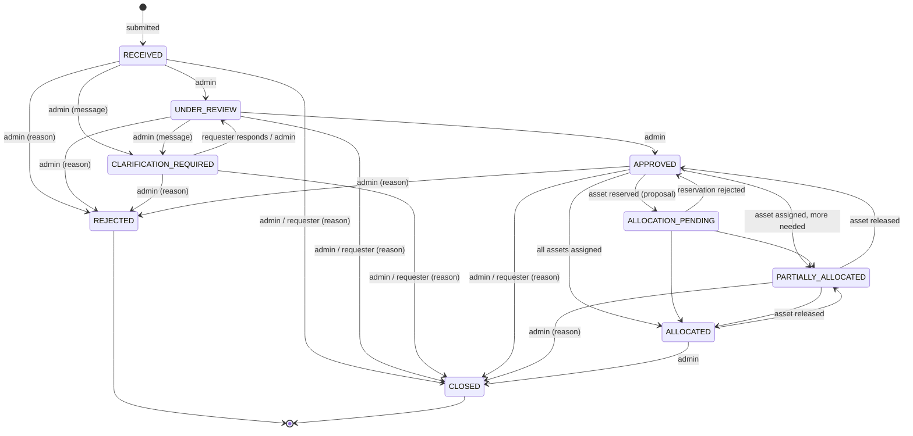

# IT Resource Request & Allocation — Core Workflow

Status: milestone 1 (core workflow). Discovery notes on the original helpdesk live in [project-discovery/](project-discovery/); this document describes what was added on top.

## Purpose

Requesters at an institution (students, staff, faculty) ask for IT resources: computers, workstations, servers, GPU systems, networking or storage. IT administrators review the request, ask for clarification if needed, approve or reject it, and assign specific inventory assets. Every status change and allocation is recorded.

The existing support-ticket workflow (tickets, AI triage, knowledge base, agent dashboard) is unchanged and still available under **Support Tickets**. Resource requests are **not** sent to the AI worker; AI-assisted requirement extraction and matching are planned for a later milestone.

## Roles

| Role | How it is obtained | Can do |
|---|---|---|
| `user` (requester) | Public registration (always `user`) | Submit requests; view, edit (while `RECEIVED`/`CLARIFICATION_REQUIRED`), respond to clarification and withdraw **their own** requests |
| `admin` (IT administrator) | `npm run set-role` (see below) | Everything a requester can do, plus: review all requests, transitions, inventory management, assignment |
| `agent` | `npm run set-role` | Legacy support-ticket role; treated as a requester for resources |

Promote an existing account (non-destructive; changes only that user's role):

```bash
cd server
npm run set-role -- --email someone@college.edu --role admin
```

## Request lifecycle



Rules (enforced in the backend; source of truth: [server/src/domain/resourceCatalog.js](../server/src/domain/resourceCatalog.js)):

- Manual transitions are limited to the `MANUAL_TRANSITIONS` table, with per-transition roles and a required `reason`/`message` where noted.
- `ALLOCATION_PENDING`, `PARTIALLY_ALLOCATED`, `ALLOCATED` (and falling back to `APPROVED`) are **never set manually**. They are derived from recorded assignments by `deriveAllocationStatus`, so a request cannot be "allocated" without assignment records.
- `REJECTED` and `CLOSED` are terminal. Nothing (including the AI triage endpoint, which only handles support tickets) can reopen them.
- Rejecting requires that nothing is assigned or reserved; closing requires that no reservation is pending. Closing **keeps** active assignments and all records (assets stay with the requester until an admin releases them).
- Clarification keeps the request's content; the requester's answer and any edits are recorded in history. The submission as originally received is kept in `original` and never modified.
- Each transition is a single conditional update (`status` precondition in the filter), so concurrent transitions cannot both succeed.

## Data model

| Collection | Model file | Key fields |
|---|---|---|
| `resourcerequests` | [ResourceRequest.js](../server/src/models/ResourceRequest.js) | `requester`, `department`, `title`, `category`, `purpose`, `description`, `specifications`, `quantity` (1–50), `urgency`, `neededBy`, `original` (immutable snapshot), `status`, `allocation {active, proposed}`, `rejection`, `pendingClarification`, `closure`, `history[]` |
| `assets` | [Asset.js](../server/src/models/Asset.js) | `assetTag` (unique, immutable), `name`, `category`, `manufacturer`, `model`, `serialNumber`, `specs`, `operatingSystem`, `software[]`, `location`, `department`, `status`, `currentAssignment`, `notes`, timestamps |
| `assignments` | [Assignment.js](../server/src/models/Assignment.js) | `request`, `asset`, `status` (`proposed`/`active`/`rejected`/`released`), `isCurrent`, `assignedBy/At`, `approvedBy/At`, `endedBy/At`, `endReason`, `notes` |
| `users` | [User.js](../server/src/models/User.js) | added optional `department` |
| `notifications` | [Notification.js](../server/src/models/Notification.js) | added type `request_update` |

- **Specifications** (`specifications` on requests, `specs` on assets) share one vocabulary (`SPEC_FIELDS`: CPU cores, memory, storage, GPU model/count/memory, OS, form factor, network ports/speed). All optional; unknown keys and out-of-range values are rejected at the API and by a Mongoose validator. Categories declare which fields are most relevant (shown first in the UI).
- **History** is embedded in the request and written in the same update as the status change.
- **Assignments** are never deleted; ending one sets `status` and `isCurrent=false`.
- **Indexes**: requests `{requester, createdAt}`, `{status, createdAt}`, `{category, status}`, `{urgency, status}`; assets unique `{assetTag}`, `{category, status}`, `{status, updatedAt}`; assignments partial-unique `{asset}` where `isCurrent: true`, `{request, status}`, `{asset, createdAt}`, `{status, createdAt}`.
- **Migration**: none required. All new collections; the two additive fields default to empty. No existing data is modified. Indexes are built by Mongoose `autoIndex` on startup.

Asset statuses: `available`, `reserved` (held by a proposal), `allocated` (held by an active assignment), `maintenance`, `unavailable`, `retired`. Admins may set only `available`/`maintenance`/`unavailable`/`retired`, and only while the asset holds no assignment.

## Allocation consistency strategy

Implemented in [allocationService.js](../server/src/services/allocationService.js).

1. Each assign / approve / reject / release runs in **one MongoDB transaction** touching Asset, Assignment and ResourceRequest.
2. Every write is a **conditional update** whose filter is the precondition:
   - asset `{status: 'available', currentAssignment: null}` → claimed;
   - request `{status ∈ APPROVED|ALLOCATION_PENDING|PARTIALLY_ALLOCATED, active + proposed < quantity}` → counter incremented;
   - assignment `{status: 'proposed'}` → approved, etc.
3. A failed precondition throws, aborting the transaction and rolling back earlier writes (e.g. an asset claimed for a request that turns out to be full is released).
4. Concurrent claims of the same asset conflict on the asset document; MongoDB aborts one, the driver retries it, its precondition then fails → `409`. Exactly one succeeds.
5. **Second guard**: a partial unique index on `assignments.asset` where `isCurrent: true` makes two current assignments for one asset impossible at the database level, even if application logic regressed.
6. The request's `allocation` counters are denormalised for the atomic capacity check; Assignment documents remain the source of truth and are updated in the same transaction.

Verified deployment: the configured Atlas cluster is a 3-member replica set on MongoDB 8.0, so transactions are supported. On a standalone `mongod` (no replica set) allocation endpoints return **503** with an explanatory message rather than running without atomicity; all other features work. For local development use Atlas or `mongod --replSet`.

## API

All under `/api`, JSON, Bearer auth. Errors use the existing `{ error, message }` shape. List endpoints accept `page` (≥1) and `limit` (1–100, default 20) and return `{ items, total, page, limit }`. Mongoose validation/cast errors now return `400` and duplicate keys `409` (previously `500`).

| Method | Path | Who | Purpose |
|---|---|---|---|
| GET | `/catalog` | any | Categories, spec fields, urgency levels, statuses (UI source of truth) |
| POST | `/requests` | any | Submit a request (`title, category, purpose, description, specifications?, quantity?, urgency?, neededBy?, department?`) |
| GET | `/requests` | any | List — own requests for non-admins; admins see all. Filters: `status` (comma list), `category`, `urgency`, `q`, `mine`, `sort=newest\|oldest` |
| GET | `/requests/overview` | admin | Counts by request/asset status, pending reservations, oldest open requests |
| GET | `/requests/:id` | owner, admin | Detail incl. requester, assignments, history, `allowedTransitions`, `canEdit`, `canRespondToClarification` |
| GET | `/requests/:id/history` | owner, admin | History only |
| PATCH | `/requests/:id` | owner | Edit requirements while `RECEIVED`/`CLARIFICATION_REQUIRED` |
| POST | `/requests/:id/transitions` | per rule | `{ to, reason?, message? }` |
| POST | `/requests/:id/clarification-response` | owner | `{ message, updates? }` → back to `UNDER_REVIEW` |
| POST | `/requests/:id/assignments` | admin | `{ assetId, mode: 'assign'\|'propose', notes? }` |
| GET/POST | `/assets` | admin | List (filters `status`, `category`, `q`) / create |
| GET/PATCH | `/assets/:id` | admin | Detail with current assignment and assignment history / edit (asset tag immutable) |
| GET | `/assignments` | admin | List (filters `status`, `request`, `asset`) |
| POST | `/assignments/:id/approve` | admin | Proposed → active |
| POST | `/assignments/:id/reject` | admin | Proposed → rejected, asset released (`{ reason? }`) |
| POST | `/assignments/:id/release` | admin | Active → released, asset available (`{ reason? }`) |

Other API change: `POST /auth/register` no longer accepts `role` (stripped; always `user`) and accepts optional `department`. Login/register responses now also include `_id` and `department`.

## Authorization summary

- Role and ownership checks are done in the backend on every endpoint; the frontend only hides controls.
- Requesters can read only their own requests (others get `404`, so IDs cannot be probed).
- Inventory and assignment endpoints require `admin`.
- Clients cannot set `status`, `requester`, `allocation`, `history`, asset `currentAssignment` or `allocated/reserved` asset status — these fields are not in any request schema and are stripped or rejected.
- New code logs IDs, status changes and changed field names, not request content or credentials. The pre-existing notification service still `console.log`s each notification's text, which for resource notifications includes the request title.

## Frontend screens

| Screen | Route | Role |
|---|---|---|
| My Requests | `/requests` | all |
| Submit Request | `/requests/new` | all |
| Request Details (+ clarification response, withdraw) | `/requests/:id` | owner |
| Overview | `/admin` | admin |
| Request Queue (filters in URL) | `/admin/requests` | admin |
| Request Details & Assignment | `/admin/requests/:id` | admin |
| Inventory | `/admin/inventory` | admin |
| Create / Edit Asset (+ assignment history) | `/admin/inventory/new`, `/admin/inventory/:id` | admin |
| Assignments | `/admin/assignments` | admin |

After login, admins land on `/admin`, everyone else on `/requests`. The registration form no longer offers a role picker. Candidate assets on the assignment panel are filtered by status `available` and (optionally) the request's category only — there is **no requirement matching yet**.

## Operations

```bash
cd server
npm run set-role -- --email <email> --role admin   # promote one existing user
npm run seed:inventory                              # optional: add 8 demo assets; inserts only missing asset tags
```

Do **not** run `npm run seed` against a shared database: it deletes users, articles, tickets and config.

## Tests

| Suite | Command | Result at time of writing |
|---|---|---|
| Server (Jest, in-memory replica set) | `cd server && npm test` | 8 suites, 33 tests pass |
| Frontend new tests | `cd frontend && npx vitest run src/__tests__/requestForm.test.ts src/__tests__/resourcePages.test.tsx` | 6 tests pass |
| Frontend legacy tests | `cd frontend && npx vitest run` | 5 legacy files still fail as before (written for Jest: `jest.mock`/`jest.fn`) |

Server test infrastructure changes: Jest now runs as native ESM (`NODE_OPTIONS=--experimental-vm-modules`, `transform: {}`); test secrets come from `src/tests/env.js`; MongoDB runs as an in-memory **replica set** so transactions are exercised; the undeclared `nock` dependency was replaced by a small stub HTTP server (`src/tests/helpers/agentStub.js`). The first test run downloads a MongoDB binary.

New server tests cover: submission and validation; requester isolation; role checks on inventory and assignment; valid/invalid transitions; rejection reason persistence; clarification round-trip with original preserved; assignment of available vs unavailable assets; concurrent assignment of one asset to two requests; concurrent over-allocation of one request; proposals (approve/reject); release; closing with assignments kept; transaction rollback when the request is full after the asset was claimed; and rollback when writing the assignment fails. The safety tests were checked by temporarily removing the transaction and the availability guard — each removal made tests fail.

## Known limitations

- No requirement-to-asset matching; admins compare specs manually.
- Requests are not linked to the AI worker or to email intake (later milestones).
- No asset deletion (by design: use `retired`), no bulk import, no asset return due dates.
- Resource notifications are in-app only and reuse the existing 30-second polling bell (not shown for admins, as before).
- Requester edits after submission are possible via API (`PATCH`) in `RECEIVED`, but the UI only offers editing as part of a clarification response.
- Pre-existing issues documented in [project-discovery/RELIABILITY_ASSESSMENT.md](project-discovery/RELIABILITY_ASSESSMENT.md) for the support-ticket module (e.g. ticket IDOR, synchronous AI triage) are unchanged.
