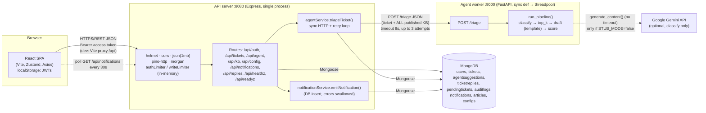
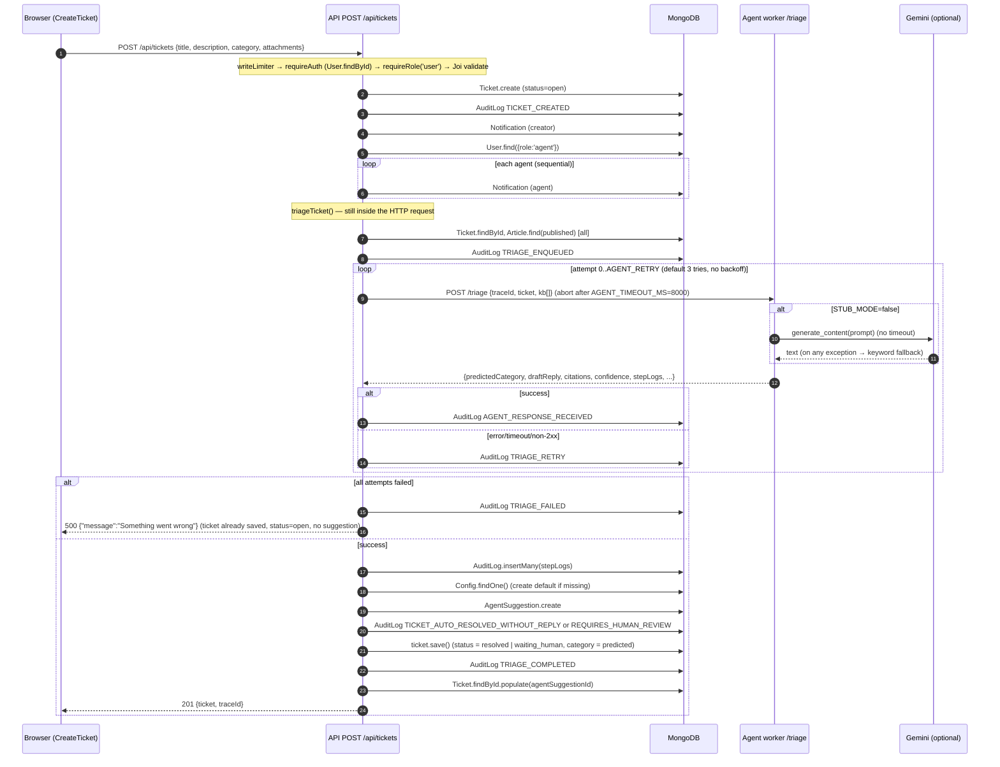

# Architecture

All statements here come from source code. "Docker Compose" topology is **not** described because no compose file exists in the repo (it is listed in [.gitignore](../../.gitignore)).

## Running components

| # | Component | Process / entry | Default port | Responsibilities | State owned |
|---|---|---|---|---|---|
| 1 | **Frontend SPA** | `vite` dev server ([frontend/package.json](../../frontend/package.json)), entry [main.tsx](../../frontend/src/main.tsx) → [App.tsx](../../frontend/src/App.tsx) | 5173 (Vite default) | UI for all roles; proxies `/api` → `http://localhost:8080` in dev ([vite.config.ts:9-15](../../frontend/vite.config.ts#L9-L15)) | Access token, refresh token and user object in `localStorage['auth-storage']` ([stores/auth.ts:104-111](../../frontend/src/stores/auth.ts#L104-L111)) |
| 2 | **API server** | `node src/index.js` ([index.js](../../server/src/index.js)) | 8080 ([config.js:5](../../server/src/config.js#L5)) | Auth, RBAC, tickets, replies, review workflow, KB CRUD and search, config, notifications, audit; **orchestrates triage inline** | All application state, via MongoDB. In-process rate-limit counters (memory store). |
| 3 | **Agent worker** | `uvicorn` serving FastAPI app in [agent/app/main.py](../../agent/app/main.py) | 9000 | Stateless `/triage`: classify → retrieve → template draft → score | None. Configuration is read once at import. |
| 4 | **MongoDB** | external | 27017 | Persistence for all 9 collections | Everything durable |
| 5 | **Google Gemini** *(optional)* | external SaaS | n/a | Classification only, when `STUB_MODE=false` and `GEMINI_API_KEY` is set | n/a |

No message broker, cache, object store, email/SMS provider, cron or background worker exists.

## Architecture diagram (verified)

## Communication

| From → To | Protocol | Sync/async | Evidence |
|---|---|---|---|
| Browser → API | HTTP/JSON, `Authorization: Bearer <access JWT>` | Synchronous request/response | [lib/api.ts](../../frontend/src/lib/api.ts) |
| Browser → API (notifications) | HTTP polling every 30 s | Client-side timer | [stores/notifications.ts:85-95](../../frontend/src/stores/notifications.ts) (`setInterval(..., 30000)`) |
| API → Agent worker | HTTP POST `${AGENT_BASE_URL}/triage`, `node-fetch` with `AbortController` timeout | **Synchronous, inside the user's `POST /api/tickets` request** | [routes/tickets.js:72](../../server/src/routes/tickets.js#L72), [agentService.js:67-135](../../server/src/services/agentService.js#L67-L135), [utils/httpClient.js](../../server/src/utils/httpClient.js) |
| Agent worker → Gemini | `google.generativeai` SDK, blocking call | Synchronous inside `/triage`; no explicit timeout | [llm_provider.py:120-121](../../agent/app/llm_provider.py#L120-L121) |
| API → MongoDB | Mongoose (default pool) | `await`ed per call; no transactions | throughout `server/src` |

The agent worker is **a synchronous RPC microservice, not a job queue**. Nothing is enqueued. The `TRIAGE_ENQUEUED` audit action ([agentService.js:34-45](../../server/src/services/agentService.js#L34-L45)) is a misnomer written just before the inline HTTP call.

## State ownership

| State | Owner | Notes |
|---|---|---|
| Users, credentials (bcrypt hash), roles | API → `users` | Role is re-read from the DB on every request ([middleware/auth.js:12](../../server/src/middleware/auth.js#L12)). |
| Tickets and status | API → `tickets` | Mutated by many endpoints with read-modify-write `save()`. |
| AI output | API → `agentsuggestions` | One per triage run; re-triage creates another. |
| Conversation | API → `ticketreplies` | |
| Agent review state | API → `pendingtickets` | Array-valued `status`. |
| Audit trail | API → `auditlogs` | Also receives the worker's `stepLogs`, persisted by the API. |
| Notifications | API → `notifications` | Polled by the client. |
| KB | API → `articles` | The **entire published KB** is shipped to the worker on every triage. |
| Runtime settings | API → `configs` (first doc) | Env vars `AUTO_CLOSE_ENABLED`, `CONFIDENCE_THRESHOLD` and `SLA_HOURS` are parsed but **never used**. |
| Session tokens (client) | Browser localStorage | No server-side session or revocation. |
| Rate-limit counters | API process memory | Lost on restart; not shared across instances. |

## Request flow: ticket creation and AI processing

Worst-case latency for `POST /api/tickets` when the worker hangs is about `(AGENT_RETRY+1) × AGENT_TIMEOUT_MS` = 3 × 8 s = **~24 s**, plus the DB calls. The worker may still be running (and calling Gemini) after the API aborts.

## Startup dependencies and ordering

1. **MongoDB must be reachable before the API starts.** `connectDb()` is awaited once with no retry; failure calls `process.exit(1)` ([index.js:6-14](../../server/src/index.js#L6-L14)).
2. **The agent worker is not needed at API startup**, but every `POST /api/tickets` fails with 500 when it is down, after the ticket is already persisted.
3. **The frontend** needs the API at `localhost:8080` (hardcoded Vite proxy target) or a `VITE_API_BASE` pointing at it.
4. **Seeding** (`npm run seed`) is required for usable logins and KB, since registration exists but there is no KB without the seed.

`/api/healthz` and `/api/readyz` return static JSON without checking MongoDB or the worker ([routes/health.js](../../server/src/routes/health.js)). The worker's `/healthz` is also static.

## Single points of failure

| SPOF | Impact | Evidence |
|---|---|---|
| Agent worker availability | Ticket creation returns 500 for every request; orphan `open` tickets accumulate. | [tickets.js:72](../../server/src/routes/tickets.js#L72), [agentService.js:118-133](../../server/src/services/agentService.js#L118-L133) |
| API ↔ worker latency | User-facing request holds open for up to ~24 s. Express handles it concurrently, but each in-flight request holds a socket. | as above |
| MongoDB | Everything fails. There is no startup retry, and readiness does not reflect DB state. | [index.js](../../server/src/index.js), [health.js](../../server/src/routes/health.js) |
| Single API process | Rate limits and nothing else are in memory, so the API is stateless enough to scale horizontally, but the limits would then be per instance. | [rateLimit.js](../../server/src/middleware/rateLimit.js) |
| Gemini (when enabled) | Silent degradation to keyword classification, not failure. | [llm_provider.py:169-187](../../agent/app/llm_provider.py#L169-L187) |
